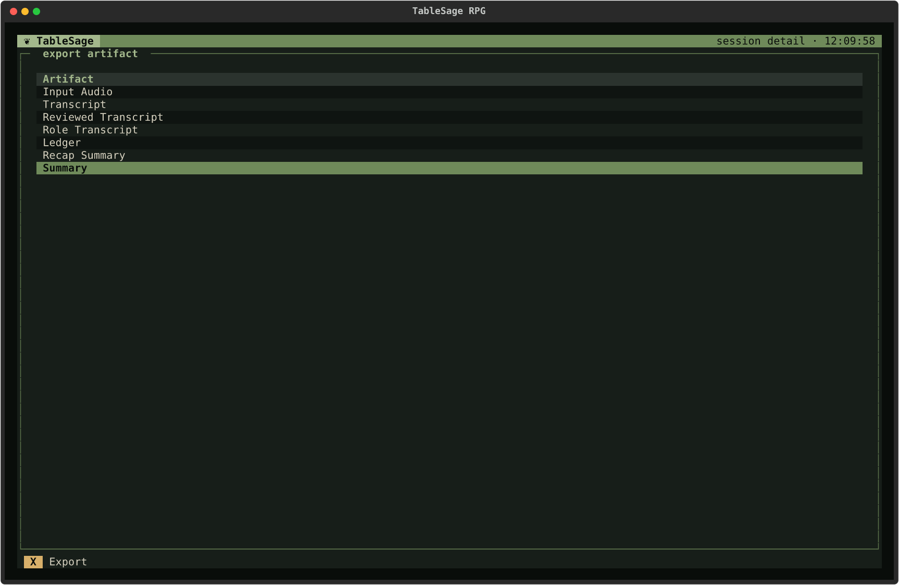

# Generate and Export Session Outputs

Processing generates **Ledger**, **Scene Log**, ten internal Matters artifacts, their visible **Post-Session Matters** JSON combination, and a deterministic Markdown **Summary** meant for reading aloud. A subsequent LLM step generates **Table Recap** from Summary for spoken delivery in the second person. Hidden artifacts are omitted from **Regenerate Artifact** and **Export Artifact**, but the dependency graph rebuilds them when needed. Previously On and campaign preparation Opportunities are also temporarily unavailable.

Produce the documents you want to share with players or keep for reference, then export copies to a location you choose. Initial generation happens at the end of processing; you can return later to rebuild an output or refresh the Campaign.

You need a Session that has completed processing its audio recording. If you have not reached that point, follow [Process a Session with New Players](process-session-new-players.md) or [Process a Session with Returning Players](process-session-returning-players.md). 

## Choose Your Artifacts

Use different artifacts, depending on how you will use them.

| Your task                                                                                               | Output to use                                                            |
| ------------------------------------------------------------------------------------------------------- | ------------------------------------------------------------------------ |
| Send players an account of the latest Session                                                           | **Summary**, the player-ready session summary                            |
| Read or paraphrase the latest Session recap to players | **Table Recap** |
| Look up what happened and which facts were established                                                  | **Ledger**, exported as readable Markdown or structured JSON             |
| Inspect or share the Session’s historical, present and open matters | **Post-Session Matters**, exported as JSON |
| Check what was actually said in a session                                                               | **Role Transcript**                                                      |
| Build a recap that highlights things in the campaign that are likely to be relevant in the next session | [Create Previously On](prepare-the-next-session.md#create-previously-on) |

The **Scene Log** contains scenes, events, discoveries and scene/session cues. Separate internal Matters artifacts track Present Matters, Goals, Obligations, Brewing Troubles, Goal Impediments, Opportunities, Mysteries, New Assets, Revelations and Developments. **Post-Session Matters** combines those ten stored publications in one JSON file without generating or rewriting their content. It appears in the artifact panel, regeneration choices and export list. Reassembling current inputs needs no model API key; missing or stale inputs may require model generation first. Transcript Sections and optional Player Introductions remain internal artifacts. See [Session Artifacts](../concepts/sessions.md#session-artifacts) for more details about generated artifacts.

**Summary** uses the existing filtered titles and primary text without descriptions, details, IDs or ratings, under headings meant to be spoken: **Last session...**, **You learned**, **You gained**, **Your goals**, **Standing in your way**, **What could help**, **Still unanswered**, **Promises and debts**, **Meanwhile**, **As we return** and **The danger right now**. Empty groups are omitted. The Matters prompts word each entry in sentence case to read naturally after its heading. If Post-Session Matters is current, rendering or regenerating Summary needs no model API key. Export copies `summary.md`; no structured JSON companion is generated.

**Table Recap** preserves every Summary section and bullet, addressing the player-character group as “you” while retaining individual character names. It combines the current position and any immediate danger into one closing prose passage under **As we return**. Generating it requires an LLM connection; exporting the existing Markdown does not. Regenerating Summary through the app also updates the dependent Table Recap.

To regenerate only the Table Recap from a current Summary, run `tablesage regenerate-table-recap --campaign NAME --session NUMBER` from the workspace folder. This command requires model credentials and does not rebuild missing or stale prerequisites. `tablesage regenerate-session-summary` remains a direct, model-free Summary render; regenerate the Recap afterward if needed.

## Read the Artifacts Panel

<<# Screenshot of the artifacts panel on the session detail screen, with artifacts in various states of exist, doesn't exist, or stale/out of date #>>

The **Artifacts** panel on Session Detail lists the user-facing [artifacts](../concepts/sessions.md#session-artifacts) and marks each one:

| Mark | Meaning                                                                |
| ---- | ---------------------------------------------------------------------- |
| ●    | Current: it exists and no processing changes have been detected.       |
| ◐    | Out of date: it exists, but something it depends on has changed since. |
| ○    | Missing: it hasn't been produced yet.                                  |
## Export an Artifact

**Export** copies an artifact out of the Session so you can use it elsewhere. It never moves or changes the original.

1. Press **X** (**Export**) in the main footer. It is available once at least one artifact exists.
2. Choose an artifact and press **X** (or **Enter**).
3. Choose where to save it.



You can stay on the Export screen and export several artifacts in a row. Two details to know:

- If the artifact is out of date, TableSage warns you and asks whether to export it anyway.
- The **Ledger** and **Scene Log** can be exported as **JSON** (the structured record) or **Markdown** (a readable version). You are asked which you want.

## Regenerate an Artifact

Use this when you want TableSage to write an output again and the reviewed transcript is already correct and current. For example, regenerate **Summary** after editing its Jinja template.

1. On Session Detail, press **?** to open **Other actions**, then choose **Regenerate Artifact** (**R**).
2. Choose what to rebuild: **Role Transcript**, **Transcript Sections**, **Ledger**, **Scene Log**, **Player Introductions**, **Table Recap**, or **Summary**.
3. Confirm. TableSage rebuilds the artifact you chose and updates the outputs that depend on it.

Regenerate Artifact is available only when the Session has a current reviewed transcript, because every generated output is built from it. A reviewed transcript explicitly accepted through a backed-up maintenance migration also meets this requirement; see [Processing State and Freshness](../reference/processing-state-and-freshness.md#explicitly-adopted-reviewed-transcripts). It runs as a normal processing run, so it can't overlap another one; if processing is already running, TableSage tells you to wait.

## Regenerate Session Summary from the Terminal

From your workspace directory (the folder containing `.tablesage/`), run:

```sh
tablesage regenerate-session-summary --campaign Brandonsford --session 001
```

Use the exact Campaign name and the Session sequence number. This archives any previous summary and replaces that Session’s `summary.md` using its current Post-Session Matters, existing Scene Log Session cue, recorded date, and the latest Jinja template, records completion and prints the output path. It opens no TUI and requires no model API key. Missing, stale or invalid inputs produce an error; the command does not rebuild upstream artifacts or call an LLM. The workspace database and settings must already be initialized for the installed version.

For this source checkout, use its virtual environment’s `tablesage` executable. For example, from the repo’s `deployment/` directory:

```sh
../.venv/bin/tablesage regenerate-session-summary --campaign Brandonsford --session 001
```

## Regenerate Every Session in a Campaign

From the Campaign Screen, use **Regenerate All Outputs** (on the secondary actions panel - press **?**) to refresh the whole Campaign's outputs after upgrading TableSage (updated prompts mark existing outputs out of date), and before building [Previously On or Opportunities](prepare-the-next-session.md), which need every recorded Session’s Scene Log to be current.

Sessions whose transcript review isn't complete and current are skipped, and the message shown when it finishes says how many. A later Session that needs a missing or stale earlier Scene Log remains blocked until that earlier Session can be regenerated. If no imported-audio Session has a current completed review, nothing is generated. Process any skipped Sessions separately, then run the action again.

## Check the Exported Copy

After the export notification appears, open the file from the location you chose and check that it is the version you want to use. Read a summary before sharing it, especially names, commitments, and other details your players will rely on.

## If Something Fails

If **Regenerate Artifact** or **Extract Glossary** fails, TableSage shows an error notification and records the failure beside the affected step on [Process Session](../reference/screens/process-session.md#what-the-screen-shows). Open that screen to inspect the failure, fix its cause, and press **Continue** to retry. Export and campaign-wide regeneration failures appear in notifications.

If the cause isn't clear, an AI coding agent started in your workspace can read the logs and the Session's records to find it; see [Advanced Help](advanced-help.md) and the [Troubleshooting FAQ](../reference/troubleshooting-faq.md).

Related tasks: to discard processing and import the recording again, see [Start the Session Over](correct-processed-session.md#start-the-session-over). For fresh vocabulary proposals from a Session, use Session Detail's **Extract Glossary**; see [Get Fresh Term Proposals from a Session](build-campaign-glossary.md#get-fresh-term-proposals-from-a-session).
